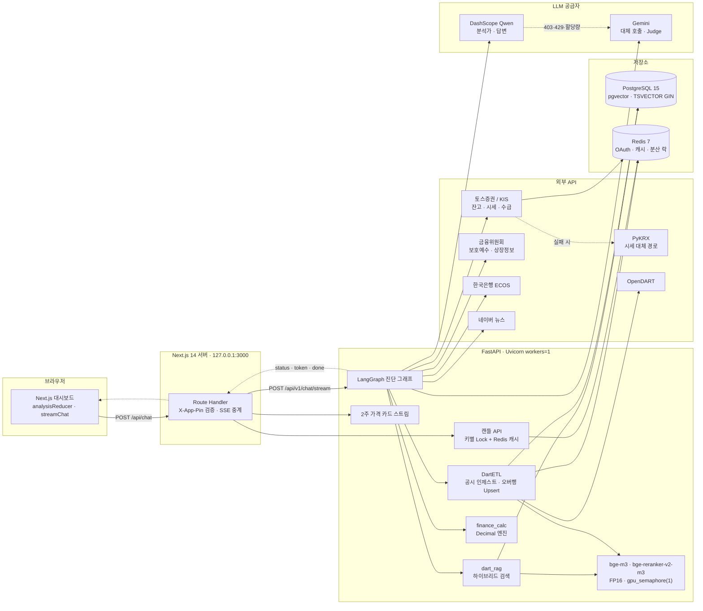
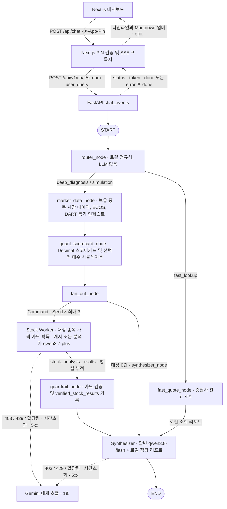

# FinGuard AI

**국내 주식 계좌 진단 도구. 공시·오버행·수급·거시 지표를 병렬로 수집하고, 수치는 `Decimal` 엔진이 계산하며, LLM은 인용이 검증된 공시 해석만 맡습니다.**


<!--
[데모 영상/스크린샷 자리]
추천 캡처 순서:
1. PIN 입력 화면 → 계좌 대시보드 첫 화면(보유 종목 표, 평가액, 주문 가능 현금).
2. "내 계좌 지금 위험한 거 없어?" 질의 직후의 진행 타임라인.
   router_node → market_data_node → quant_scorecard_node → 종목별 stock_worker(병렬 3개) → guardrail_node → synthesizer_node
   단계가 실시간으로 바뀌는 모습을 GIF로 녹화하면 SSE 스트리밍이 잘 드러납니다.
3. 완성된 리포트의 "### 핵심 답변 / ### 판단 근거" 섹션. [DOC-N] 링크가 DART 원문으로 연결되는 부분을 포함합니다.
4. DASHSCOPE_API_KEY와 GEMINI_API_KEY를 비운 상태에서 같은 질의를 실행한 화면.
   경고 배너와 함께 로컬 스코어카드·희석률이 그대로 나오는 장면은 장애 격리 설계를 보여 줍니다.
5. 종목 검색 → 2주 가격 카드(단기 저점·단기 고점·2주 상단, AI/기본 계산 배지)와 10분봉 캔들 차트.
-->
<!--  -->

---

## 목차

1. [기획 배경과 해결하려는 문제](#1-기획-배경과-해결하려는-문제)
2. [시스템 아키텍처](#2-시스템-아키텍처)
3. [기술적 의사결정과 트레이드오프](#3-기술적-의사결정과-트레이드오프)
4. [트러블슈팅과 성능 최적화](#4-트러블슈팅과-성능-최적화)
5. [엔지니어링 구현 포인트](#5-엔지니어링-구현-포인트)
6. [로컬 실행과 환경 설정](#6-로컬-실행과-환경-설정)
7. [평가와 테스트](#7-평가와-테스트)
8. [알려진 한계](#8-알려진-한계)

---

## 1. 기획 배경과 해결하려는 문제

### 기존 방식의 한계

| 한계 | 구체적 상황 |
| --- | --- |
| 정보가 흩어져 있음 | 보유 종목의 전환사채(CB)·신주인수권부사채(BW) 발행, 의무보호예수 해제, 외국인·기관 수급, 환율·금리는 각각 DART, 금융위원회 공공데이터, 증권사, 한국은행 ECOS에 따로 있습니다. 개인 투자자가 이를 계좌 기준으로 매일 대조하기는 어렵습니다. |
| LLM이 숫자를 지어냄 | 범용 LLM에 "평단가가 얼마가 되나", "희석률이 몇 %인가"를 물으면 그럴듯한 숫자를 만들어 냅니다. 금융 진단에서 숫자 하나가 틀리면 리포트 전체를 믿을 수 없습니다. |
| 출처를 확인할 수 없음 | LLM 답변이 어떤 공시를 근거로 했는지 확인할 수 없고, 존재하지 않는 공시번호를 인용하기도 합니다. |
| 데이터 예외가 많음 | 우선주는 DART 고유번호(`corp_code`)가 없습니다. ETF·ETN은 재무제표가 없습니다. 장중 수급은 확정값이 아닙니다. 1~3월에는 전년도 사업보고서가 아직 없습니다(`status: 013`). |

### 목표

1. **수치와 해석을 분리합니다.** 재무·수급·희석률·평단가·스코어카드는 Python `Decimal` 엔진이 계산하고, LLM은 공시 원문을 해석하는 일만 맡습니다.
2. **모든 인용을 검증할 수 있게 합니다.** LLM에는 14자리 공시번호 대신 `DOC-N` 별칭만 보여 주고, 등록되지 않은 별칭을 인용한 문장은 형태소 기준 문장 단위로 제거합니다.
3. **외부 의존성이 실패해도 결과를 냅니다.** LLM 공급자나 데이터 소스 일부가 실패해도 SSE 스트림은 로컬 계산 결과와 경고를 담아 정상 종료합니다.
4. **로컬 GPU 하나로 운영합니다.** RTX 5060 8GB VRAM에서 임베딩과 리랭킹 모델을 함께 상주시켜 OOM 없이 돌립니다.
5. **조회만 합니다.** 매매 주문 API는 구현하지 않습니다. LLM 오작동으로 주문이 나갈 경로를 처음부터 없앴습니다.

상세 요구사항: [PRD v3.8](docs/finguard_ai_prd_v3.8.md)

---

## 2. 시스템 아키텍처

### 전체 데이터 흐름



### LangGraph 워크플로우



FastAPI는 그래프 실행 전에 첫 `status(router_node, started)`를 먼저 보냅니다. 그래서 첫 이벤트(TTFE)가 LLM 응답 시간과 무관합니다. 완료 프레임(`done`)에는 `final_report`와 함께 `intent_type`, `account_summary`, `holdings`, `quant_scorecards`, `macro_context`, `simulation_result`, `verified_stock_results`, `guardrail_warnings`가 담깁니다. 내부 필드(`balance`, `score_inputs`, `stock_analysis_results`)는 `output_keys=PUBLIC_FIELDS`로 걸러 클라이언트에 보내지 않습니다.

| 역할 | 모델 설정 및 기본값 | 공급자 키 |
| --- | --- | --- |
| 2주 가격 카드 분석가 | `ANALYST_MODEL=qwen3.7-plus` | `DASHSCOPE_API_KEY` |
| 채팅 질문 답변 (Node 6) | `ANSWER_MODEL=qwen3.8-flash` | `DASHSCOPE_API_KEY` |
| 장애 대체 (분석가·답변 공통) | `FALLBACK_MODEL=gemini-3.8-flash` | `GEMINI_API_KEY` |
| Module 8 RAGAS Judge | `JUDGE_MODEL=gemini-3.8-flash` | `GEMINI_API_KEY` |

의도 분류는 LLM 없이 로컬 정규식이 맡고, 종목별 위험 분석문을 쓰던 워커 LLM 호출도 없앴습니다. Gemini는 평소 호출하지 않고 DashScope가 429·403·할당량 오류, 시간초과, 5xx를 내면 한 번만 호출합니다. 그래도 실패하면 로컬 결과를 냅니다.

DashScope의 기본 주소는 `DASHSCOPE_BASE_URL=https://dashscope-intl.aliyuncs.com/compatible-mode/v1`입니다.

| 공개 경로 (Next.js) | 동작 | 내부 경로 (FastAPI) |
| --- | --- | --- |
| `GET /api/account` | PIN 검증 후 잔고와 주문 가능 현금 조회 | `GET /api/v1/account` |
| `POST /api/chat` | PIN 검증 후 `{ "user_query": "…" }` 또는 `{ "mode": "price_bands" }` 전송, SSE 중계 | `POST /api/v1/chat/stream` |
| `GET /api/stocks/search` | PIN 검증 후 종목 코드·이름 검색 (최대 8건) | `GET /api/v1/stocks/search` |
| `GET /api/v1/stocks/{code}/candles` | PIN 검증 후 10분·일·주·연봉 캔들 조회, `X-Candle-Poll-After` 전달 | `GET /api/v1/stocks/{code}/candles` |
| — | 헬스체크 | `GET /health` |

### 디렉터리 구조

```text
finguard-ai/
├── backend/
│   ├── main.py               # FastAPI lifespan(풀·브로커·ETL 생명주기), SSE 엔드포인트, 캔들 캐시
│   ├── server.py             # Uvicorn 진입점: workers=1, SelectorEventLoop 고정
│   ├── portfolio_graph.py    # LangGraph 상태(PortfolioState)와 8개 노드, Fan-Out 라우팅
│   ├── portfolio_market.py   # 계좌 스냅샷 수집: 소스별 장애 격리, 기업 단위 병렬 수집
│   ├── finance_calc.py       # Module 3: 100점 스코어카드, 4분기 역산, PER/PBR, 매수 시뮬레이션 (I/O 없음)
│   ├── stock_analysis.py     # 종목 워커, 종합 프롬프트, 문장 단위 인용 검증(가드레일)
│   ├── citations.py          # DOC-N 별칭 체계(AliasBook)와 14자리 공시번호 마스킹
│   ├── llm.py                # 역할별 공급자 선택, 할당량 대체, 재시도, 키가 지워진 실패 로그
│   ├── report.py             # LLM 없이도 동작하는 결정론적 리포트 생성
│   ├── price_bands.py        # 로컬 가격 밴드 계산과 SSE 스트림: 로컬 결과를 먼저 전송
│   ├── price_card.py         # 선택 종목 2주 가격 카드: 재료 번호 부여, 분석가 호출, 검증, 로컬 대체, Redis 캐시
│   ├── card_validation.py    # 분석가 출력 검증: 순서·ATR 범위·근거 번호·인용·숫자 대조
│   ├── chart_levels.py       # 이동평균·스윙 고저점·매물대·ATR14 (Decimal)
│   ├── card_log.py           # 가격 카드 기록(price_card_log)과 10거래일 적중 판정
│   ├── dart_etl.py           # DART 공시·CB/BW/EB 인제스트, Redis 분산 락, 오버행 Upsert
│   ├── dart_chunks.py        # DART HTML/XML → Markdown 표 청킹(rowspan·colspan, 헤더 복제)
│   ├── dart_rag.py           # 하이브리드 SQL, Kiwi 토큰화, FP16 임베딩·리랭킹, gpu_semaphore
│   ├── connectors.py         # 금융위 보호예수, 네이버 뉴스, ECOS 환율·금리 (재시도·캐시)
│   ├── lockup_disclosures.py # 보호예수 API 실패 시 DART 증자 공시에서 해제 물량 추출
│   ├── sync_stock_master.py  # KRX·DART 스냅샷 → stock_master, 우선주 corp_code 전파
│   ├── stock_master.py       # stock_master 조회·검색 저장소
│   ├── toss_broker.py        # 토스증권 계좌 공급자 (BrokerConnector에 조합)
│   ├── broker/               # KIS 커넥터(OAuth 캐시, Semaphore(2), 재시도), PyKRX 대체 경로, 캔들 집계
│   ├── db.py                 # 프로세스 공유 AsyncConnectionPool (min 1, max 8)
│   ├── market_time.py        # KRX 캘린더, 15:40 KST 확정 시각, 캔들 폴링 간격
│   ├── serialization.py      # Decimal을 문자열로 유지하는 단일 JSON 인코더
│   ├── migrations/           # 001(stock_master·overhang_events), 004(dart_chunks), 005(market 컬럼), 006(price_card_log)
│   └── start.sh              # 컨테이너 기동: 마이그레이션 → 조건부 종목 동기화 → 서버
├── frontend/
│   ├── app/api/              # PIN 검증 Route Handler (account, chat, stocks/search, candles)
│   ├── app/dashboard.tsx     # 대시보드, 진단 타임라인
│   ├── app/price-outlook.tsx # 가격 밴드 카드
│   ├── app/toss-ten-minute-chart.tsx  # lightweight-charts 캔들 차트
│   ├── lib/backend-proxy.ts  # 상수 시간 PIN 비교, 업스트림 에러 차단 프록시
│   ├── lib/chat-stream.ts    # fetch 기반 SSE 파서 (CRLF·청크 경계 처리)
│   ├── lib/analysis-run.ts   # 진단 상태 reducer (task_id 단위 병렬 워커 상태)
│   └── tests/                # node --test 단위 테스트
├── scripts/
│   ├── dev.py                # 로컬 개발 스택 일괄 실행
│   ├── eval_ragas.py         # RAGAS 20건 평가 (dry-run / 실측, --answer-model 모델 비교)
│   ├── score_price_cards.py  # 10거래일 지난 가격 카드의 AI·로컬 적중률 채점
│   ├── benchmark_latency.py  # TTFE·TTFT·Warm/Cold 지연시간 벤치마크
│   └── smoke_test_e2e.py     # FP16 VRAM 피크 + FastAPI·Next.js 실제 HTTP 스트림 검증
├── data/eval/ragas_benchmark_20.json  # 5대 공시 유형 × 4개 발행사 평가 데이터셋
├── tests/                    # pytest (202개 수집)
├── docs/finguard_ai_prd_v3.8.md
├── docker-compose.yml        # frontend · backend(GPU) · db(pgvector) · redis
├── docker-compose.dev.yml    # 로컬 개발용 DB·Redis 루프백 포트 공개
└── Dockerfile                # nvidia/cuda:12.8.1 + uv + BuildKit pip 캐시
```

---

## 3. 기술적 의사결정과 트레이드오프

### 3.1 LLM 수치 생성 대신 결정론적 `Decimal` 엔진

**결정.** 스코어카드, 오버행 희석률, 4분기 실적 역산, PER/PBR, 매수 시뮬레이션은 [`finance_calc.py`](backend/finance_calc.py)의 순수 함수가 계산합니다. 이 모듈은 외부 I/O가 없습니다. 연산은 `Context(prec=64, rounding=ROUND_HALF_UP)`에서 수행합니다. BIGINT 크기의 두 값을 곱해도 중간 자릿수가 잘리지 않습니다.

**LLM 입력 범위.** [`cloud_context()`](backend/stock_analysis.py)는 LLM에 보낼 페이로드를 새로 만듭니다. 들어가는 값은 질문 원문(계좌번호 형태의 숫자는 `(계좌번호 생략)`으로 치환), 종목명·코드·수량·평단가·현재가·비중·수익률, 예수금·총평가액, 검증된 가격 카드, 재료(`[P-n]` 지표, `[NEWS-n]` 뉴스 제목·요약, 14자리 번호를 가린 `[DOC-N]` 공시 청크), 로컬 시뮬레이션 결과입니다. 계좌번호, 증권사·외부 API 키와 토큰, PIN은 나가지 않습니다. 이 경계는 `test_answer_context_has_question_and_account_but_no_account_number`가 검증합니다. 처음에는 종목명·비중·수익률 같은 지표만 보냈습니다. 그러나 그러면 "추가매수할까?" 같은 질문에 답할 수 없어, 계좌 숫자와 질문은 허용하고 자격증명만 막는 쪽으로 경계를 옮겼습니다.

**직렬화.** [`serialization.encode`](backend/serialization.py)는 `Decimal`을 `format(value, "f")` 문자열로 내보냅니다. API 응답, SSE 프레임, Redis 캐시, LLM 프롬프트가 모두 이 인코더 하나를 씁니다. 그래서 어느 경로에서도 float로 바뀌지 않습니다. 프론트엔드 타입도 `` DecimalString = `${number}` ``으로 선언했습니다.

**미확정 입력 처리.** 입력 하나라도 알 수 없으면(재무제표 없음, 일봉 20개 미만 등) 해당 항목 점수는 `None`이 되고 합계(`total`)도 비워 둡니다. 추정값으로 채우지 않습니다.

| 대안 | 선택하지 않은 이유 |
| --- | --- |
| LLM이 수치까지 생성 | 수치 오류를 탐지할 방법이 없습니다. 평가 목표 "정형 수치 오차율 0.0%"를 보장할 수 없습니다. |
| `float` 연산 | 평단가·비중 계산에서 이진 부동소수점 오차가 생기고, 화면 반올림 결과가 달라질 수 있습니다. |

**트레이드오프.** 스코어 규칙(수급·모멘텀·실적·오버행 각 25점)을 코드로 명시해야 하므로 유연성이 떨어집니다. 대신 같은 입력에는 항상 같은 결과가 나오고, 19개의 단위 테스트로 경계값을 고정할 수 있습니다.

### 3.2 전역 HNSW 사후 필터링 대신 기업 범위 Exact Scan + 하이브리드 랭킹

**결정.** 공시 검색은 질문이 항상 특정 기업(`corp_code`)에 한정됩니다. [`HYBRID_SQL`](backend/dart_rag.py)은 아래 순서로 실행합니다.

1. `issuer AS MATERIALIZED` CTE가 `idx_dart_chunks_corp` B-tree로 해당 기업·기간의 청크만 먼저 고정합니다.
2. 이 집합 안에서 `1 - (embedding <=> query)` 코사인 유사도를 **전수 계산**합니다.
3. 독립된 `lexical` 브랜치가 Kiwi 형태소를 `simple` 설정으로 저장한 `search_tsv` GIN 인덱스에서 `ts_rank(…, 32)`를 구합니다.
4. 두 결과를 `LEFT JOIN`으로 합산해 후보 32개를 뽑고, `bge-reranker-v2-m3` CrossEncoder로 다시 정렬해 상위 5개를 반환합니다.

`LEFT JOIN`을 쓰기 때문에 키워드가 하나도 맞지 않는 벡터 후보도 결과에서 빠지지 않습니다. 새로 적재한 볼륨에는 통계가 없어 플래너가 순차 스캔을 고를 수 있으므로, 트랜잭션 범위에서 `SET LOCAL enable_seqscan = off`를 설정합니다. `test_exact_hybrid_candidates_are_scoped_before_limit_and_reranked`는 `EXPLAIN` 결과에 `idx_dart_chunks_corp`와 `CTE Scan`이 나오는지 직접 확인합니다.

| 대안 | 선택하지 않은 이유 |
| --- | --- |
| 전역 HNSW 인덱스 + `WHERE corp_code` 사후 필터 | ANN이 먼저 상위 k개를 자른 뒤 필터를 적용하므로 해당 기업 청크가 후보에서 빠질 수 있습니다(재현율 손실). |
| 벡터 검색 단독 | "전환사채", "보호예수" 같은 정확한 용어와 숫자·영문 약어(CB, BW)를 놓칩니다. |
| PostgreSQL 기본 한국어 FTS | 기본 제공 한국어 사전이 없습니다. Kiwi로 명사·외국어·숫자·어근 품사(`NN*`, `SL`, `SN`, `SH`, `XR`)만 뽑아 `simple` 설정으로 저장했습니다. |

**트레이드오프.** 기업 하나의 청크 수(수백~수천 건)에 비례해 전수 계산 비용이 듭니다. 단일 사용자의 보유 종목 범위에서는 감당할 수 있는 크기이고, 그 대가로 검색 누락이 구조적으로 생기지 않습니다.

### 3.3 외부 임베딩 래퍼 대신 FP16 직접 로드 + 단일 GPU 세마포어

**결정.** [`dart_rag._models()`](backend/dart_rag.py)는 `sentence-transformers`의 `SentenceTransformer("BAAI/bge-m3")`와 `CrossEncoder("BAAI/bge-reranker-v2-m3", max_length=1024)`를 `torch_dtype=torch.float16`, `device="cuda"`로 직접 로드합니다. 런타임은 RTX 5060(Blackwell, `sm_120`) 커널 호환을 위해 `nvidia/cuda:12.8.1` 이미지와 `torch==2.8.0+cu128`로 고정했습니다.

- **프로세스 1개**: [`server.py`](backend/server.py)가 `workers=1`을 고정합니다. 워커가 여럿이면 각 프로세스가 모델을 따로 올려 VRAM이 배로 듭니다.
- **GPU 직렬화**: 임베딩과 리랭킹은 `gpu_semaphore = asyncio.Semaphore(1)` 하나를 공유합니다. 리랭킹 후보는 `batch_size=8`로 나눠 추론해 어텐션 메모리 스파이크를 막습니다.
- **CPU 작업 분리**: Kiwi 토큰화와 문장 분리는 `asyncio.to_thread()`로 이벤트 루프 밖에서 실행합니다.
- **VRAM 검증**: [`smoke_test_e2e.py`](scripts/smoke_test_e2e.py)가 두 모델 적재 직후 `torch.cuda.max_memory_allocated()`를 측정하고, 2.5GB(`VRAM_BUDGET_BYTES`)를 넘거나 FP16이 아닌 파라미터가 있으면 실패 처리합니다. PRD는 두 모델 합계를 약 2.2GB로 추정합니다.

| 대안 | 선택하지 않은 이유 |
| --- | --- |
| `fastembed` 등 외부 래퍼 | 모델·정밀도 지원 범위가 라이브러리에 묶입니다. 프로젝트 규칙으로 사용을 금지했습니다. |
| 클라우드 임베딩 API | 공시 청크마다 외부 호출이 생기고, 비용과 지연이 공시 수에 비례합니다. |
| FP32 로드 | VRAM 사용량이 약 2배가 되어 8GB 환경에서 여유가 줄어듭니다. |

**트레이드오프.** GPU 추론을 직렬화했으므로 동시 요청이 몰리면 대기열이 생깁니다. 이 대기가 다른 자원(DB 연결)을 붙잡지 않도록 [4.1](#41-gpu-대기-중-db-연결-풀-고갈)에서 트랜잭션 경계를 조정했습니다.

### 3.4 단일 LLM 공급자 대신 역할별 다중 공급자와 단계적 대체

**결정.** [`llm.invoke()`](backend/llm.py)는 역할(`analyst`, `answer`, `judge`)마다 모델을 고르고, 장애 대체 모델(`fallback`)은 별도로 둡니다. 두 공급자 모두 같은 Pydantic 스키마와 같은 메시지를 받습니다. 모델 이름은 `ANALYST_MODEL`·`ANSWER_MODEL`·`FALLBACK_MODEL`·`JUDGE_MODEL`로 바꿀 수 있습니다.

| 역할 | 1차 | 실패 시 |
| --- | --- | --- |
| 가격 카드 분석가 | Qwen 3.7-plus (`timeout=30`) | 403·429·할당량·시간초과·5xx면 Gemini를 한 번 호출하고, 그래도 실패하면 로컬 카드와 경고를 반환 |
| 채팅 답변 | Qwen 3.8-flash | 같은 조건에서 Gemini를 한 번 호출하고, 실패하면 로컬 `diagnosis_report`로 완결 |
| RAGAS Judge | Gemini 3.8-flash | 평가 전용이며 대체 경로 없음 |

- **할당량 판정**: HTTP 상태 코드를 예외의 `__cause__` 체인을 따라 찾고, 메시지의 `quota`, `free tier`, `allocation exhausted` 패턴도 확인합니다.
- **응답 검증**: Gemini의 안전 필터 차단(`SAFETY`, `PROHIBITED_CONTENT` 등)이나 빈 응답, 스키마 불일치는 모두 `LLMUnavailable`로 바꿔 상위에 전달합니다. DashScope는 `json_mode`에 스키마를 함께 넣고 Qwen의 추론 토큰을 `thinking_budget=2048`로 제한합니다.
- **로그 보안**: 공급자 트레이스백에 인증 헤더나 키가 담긴 URL이 섞일 수 있어, 로그에 남기기 전에 `DASHSCOPE_API_KEY`, `GEMINI_API_KEY` 값을 `[REDACTED]`로 치환합니다. SSE 에러 메시지에는 예외 내용을 넣지 않습니다.

**트레이드오프.** 공급자마다 구조화 출력 방식(`with_structured_output` vs `json_mode`)이 달라 어댑터가 둘 필요합니다. `test_real_langchain_adapters_parse_gemini_fallback`이 실제 LangChain 어댑터로 대체 경로를 검증합니다.

### 3.5 LangGraph 상태 설계: 리듀서는 버퍼에만

**결정.** [`PortfolioState`](backend/portfolio_graph.py)는 공개 필드와 내부 필드를 주석으로 나누고, 리듀서를 최소한으로 둡니다.

- `stock_analysis_results: Annotated[list, operator.add]`: 병렬 워커가 각자 결과 하나씩을 붙이는 **버퍼**입니다.
- `verified_stock_results: list`: 리듀서가 **없습니다**. 가드레일 노드가 한 번만 기록하므로 병렬 키 충돌이나 중복 누적이 생기지 않습니다.
- `fan_out_node`는 `Command(goto=...)`로 비중 상위 3종목에 `Send`를 보냅니다. 대상이 없으면 문자열 `"synthesizer_node"`를 반환합니다. 빈 `Send` 목록을 반환하면 그래프가 종합 단계 없이 끝나기 때문입니다(`test_empty_fanout_reaches_synthesis`).
- `StateGraph(PortfolioState, input_schema=Query)`이므로 요청 경계를 넘는 값은 `user_query` 하나뿐입니다. 체크포인터가 없어 이전 요청의 리듀서 채널이 남지 않습니다.

### 3.6 `DOC-N` 별칭 가드레일과 형태소 문장 단위 제거

**결정.** [`citations.py`](backend/citations.py)의 `AliasBook`은 공시번호를 처음 나온 순서대로 `DOC-1`, `DOC-2`로 번호 매깁니다. 프롬프트마다 별칭 체계를 따로 만듭니다. 워커의 `DOC-1`과 종합 노드의 `DOC-1`은 서로 다른 공시일 수 있기 때문입니다. 공시 제목과 본문의 14자리 숫자는 `(공시번호 생략)`으로 가립니다.

[`verify_results()`](backend/stock_analysis.py)의 검증 과정은 다음과 같습니다.

1. 워커 응답을 `WorkerResult` 스키마로 `strict` 검증합니다. 형식이 틀린 워커만 제외하고 나머지는 유지합니다.
2. Kiwi `split_into_sents()`로 문장을 나눕니다. 이때 `[DOC-N]` 표시를 **같은 길이의 공백으로 치환**한 문자열을 넘기고, Kiwi가 돌려준 끝 위치로 원문을 자릅니다. Kiwi가 문장 앞의 인용 표시를 이전 문장의 각주처럼 붙이는 문제를 피하면서 원문 인용 위치를 그대로 보존하는 방법입니다.
3. 등록되지 않은 별칭이나 원시 14자리 공시번호가 있는 문장만 제거하고, 경고를 `guardrail_warnings`에 남깁니다.
4. 남은 별칭은 실제 공시번호로 바꾸고, 리포트에서 `https://dart.fss.or.kr/dsaf001/main.do?rcpNo=…` 링크로 연결합니다.

가격 카드는 AI가 가격까지 정하되 코드가 검증합니다([`card_validation.py`](backend/card_validation.py)). 분석가가 낸 `low`·`high`·`ceiling`은 레벨마다 다음을 통과해야 합니다.

- 양의 정수 `Decimal`이며 KRX 호가 단위로 반올림, `low ≤ 현재가 ≤ ceiling`, `low < high ≤ ceiling`(순서가 깨지면 세 레벨 모두 로컬 값).
- 현재가와의 차이가 `4 × ATR14` 이내.
- `basis`에 실제 존재하는 `[P-n]`이 하나 이상. 인용 지표값에서 `max(1 × ATR14, 3%)`보다 멀면 `[NEWS-n]`·`[DOC-n]` 인용이 필요하고, `2 × ATR14`를 넘으면 거부.
- 미등록 번호·14자리 공시번호가 있는 문장, `원·주·%` 숫자가 재료에 없는 문장은 Drop.

실패한 레벨만 로컬 계산값으로 바꾸고 화면에 `기본 계산` 배지를 붙입니다(통과한 레벨은 `AI`). 채팅 답변도 같은 방식으로 문장 단위로 검증해, 알 수 없는 태그·14자리 번호·입력에 없는 숫자·확정 매수/매도 지시 문장을 버립니다.

### 3.7 데이터 정합성: 정정공시·우선주·회계기준

| 문제 | 해결 | 위치 |
| --- | --- | --- |
| CB/BW 기재정정 공시가 같은 사채를 여러 번 보고함. 회차(`bond_type_issue_no`)가 `NULL`인 경우도 있음 | `UNIQUE NULLS NOT DISTINCT (corp_code, bond_type_issue_no, board_resolution_date)`로 `NULL` 회차도 같은 키로 묶습니다. `ON CONFLICT DO UPDATE … WHERE overhang_events.rcept_no <= EXCLUDED.rcept_no`이므로 공시가 순서 없이 다시 적재돼도 옛 공시가 최신 정정을 덮지 않습니다. | `001_module1.sql`, `dart_etl.UPSERT_EVENT` |
| 우선주는 DART `corp_code`가 없어 공시를 추적할 수 없음 | 같은 법인등록번호(`crno`)를 가진 보통주의 `corp_code`가 **정확히 하나**일 때만 우선주에 전파합니다. ETF·ETN·리츠는 전파 대상에서 뺍니다. | `sync_stock_master.build_stock_master` |
| 종목 마스터를 다시 동기화하면 모든 행의 `updated_at`이 바뀜 | `WHERE (…) IS DISTINCT FROM (…)` 조건으로 값이 실제로 바뀐 행만 갱신합니다. | `sync_stock_master.UPSERT` |
| 4분기 실적을 구할 때 연간(CFS)에서 3분기(OFS)를 빼는 오류 | 같은 `fs_div` 쌍(CFS끼리, 없으면 OFS끼리)만 차감합니다. 계정은 XBRL `account_id`를 1순위로, 한글 계정명 정규식을 2순위로 매칭하고, 같은 순위에 서로 다른 값이 있으면 판단하지 않습니다(`None`). | `finance_calc.fourth_quarter`, `_account_amount` |
| 1~3월에는 전년도 사업보고서가 없음(`status: 013`) | CFS·OFS 모두 `013`일 때만 한 해 전 보고서로 넘어갑니다. | `finance_calc`, `portfolio_market.financial_reports` |
| 장중 수급·일봉은 확정값이 아님 | 15:40 KST 이전이면 전일까지만 확정 데이터로 봅니다(`confirmed_day`). | `market_time.py` |
| ETF·ETN은 재무·공시가 없음 | `asset_type != 'STOCK'`이면 DART·보호예수·재무 스코어카드·워커를 건너뛰고 가격·수익률·수급만 요약합니다. DB에도 `CHECK (asset_type NOT IN ('ETF','ETN') OR corp_code IS NULL)` 제약을 둡니다. | `finance_calc.calculate_scorecard`, `001_module1.sql` |

### 3.8 Redis를 캐시이자 분산 조정자로 사용

| 용도 | 구현 | 위치 |
| --- | --- | --- |
| 증권사 OAuth 토큰 | 앱 키·시크릿의 SHA-256 지문을 키로 씁니다. 만료 60초 전까지 캐시를 재사용하고, 갱신은 `redis.lock(…:refresh)` 안에서 **이중 확인** 후 한 번만 발급합니다. | `broker/kis.py::_cached_oauth` |
| 기업별 공시 인제스트 | `etl_lock:{corp_code}`(600초)를 `blocking=False`로 잡아 같은 기업을 동시에 적재하지 않습니다. 작업 중에는 200초마다 `reacquire()`로 락을 연장합니다. 같은 프로세스 안의 중복 요청은 `_pending_ingests` 작업 하나를 `asyncio.shield`로 공유합니다. | `dart_etl.py` |
| 캔들 | 캐시 키별 `asyncio.Lock`(`WeakValueDictionary`)으로 동시 요청 중 하나만 증권사를 조회합니다. TTL은 10분봉 15초, 일·주봉 1시간, 연봉 24시간입니다. 빈 결과는 캐시하지 않습니다. | `main.stock_candles` |
| ECOS 환율·금리 | 24시간 TTL, 프로세스 내 `asyncio.Lock`으로 캐시 미스 시 중복 호출을 막습니다. | `connectors.get_macro_context` |

### 3.9 로그인 없는 단일 사용자 보안: PIN 프록시

**결정.** 회원 체계 대신, 브라우저는 Next.js 서버에만 접근하고 FastAPI는 Compose 내부(`expose: 8000`)에만 노출합니다. 프론트엔드 포트는 `127.0.0.1:3000`에만 바인딩합니다.

- [`hasValidPin()`](frontend/lib/backend-proxy.ts)은 입력 PIN과 `APP_ACCESS_PIN`을 각각 SHA-256으로 해시한 뒤 `timingSafeEqual`로 비교합니다. 해시로 길이를 맞추므로 길이 차이로 인한 타이밍 정보도 새지 않습니다.
- `forwardJson()`과 채팅 프록시는 백엔드의 에러 본문을 브라우저로 전달하지 않고 고정된 한국어 메시지로 바꿉니다. 모든 응답은 `Cache-Control: no-store`이고, `redirect: "error"`로 리다이렉트를 따라가지 않습니다.
- 계좌 공급자는 상속 대신 조합으로 구성했습니다. `BrokerConnector`의 `account`에 KIS 또는 토스 공급자를 넣고, 시세·일봉·수급은 두 경우 모두 KIS 실전 도메인을 쓰며 실패하면 PyKRX로 대체합니다.

---

## 4. 트러블슈팅과 성능 최적화

아래 사례는 모두 커밋 이력과 회귀 테스트로 확인할 수 있습니다.

### 4.1 GPU 대기 중 DB 연결 풀 고갈

> 관련 커밋: `5c22701`, `876466b` · 테스트: `test_pool_commits_rolls_back_and_resets_connection_state`, `test_embedding_runs_without_holding_a_database_connection`

**문제 상황.** 비동기 DB 접근 9곳이 모두 요청마다 `AsyncConnection.connect()`로 새 연결을 열었습니다. 심층 진단 한 번에 TCP 연결과 인증이 종목 수에 비례해 수십 번 반복됐고, 공시 적재는 공시 1건마다 연결을 두 번 열었습니다. 동시 요청이 몰려도 DB 연결 수에 상한이 없었습니다.

**1차 해결.** [`db.py`](backend/db.py)에 프로세스 공유 `AsyncConnectionPool(min_size=1, max_size=8, timeout=5)`를 도입했습니다.
- `open(wait=False)`로 열어 DB가 늦게 떠도 앱 기동을 막지 않습니다.
- 블록이 성공하면 커밋, 예외가 나면 롤백합니다. 기존 직접 연결과 트랜잭션 의미가 같습니다.
- 연결이 재사용되므로 체크아웃할 때마다 `row_factory`를 다시 지정합니다. 앞 요청의 `dict_row` 설정이 다음 요청으로 새지 않게 하기 위해서입니다.
- 종료는 `AsyncExitStack`으로 ETL 작업 취소 → 브로커 클라이언트 → 풀 순서로 진행합니다.

**새로 드러난 원인.** 풀 상한이 8개가 되자 기존 코드의 다른 문제가 드러났습니다. `_index_report`는 트랜잭션을 먼저 연 뒤 그 안에서 8청크씩 GPU 임베딩을 기다리며 INSERT를 반복했습니다. GPU는 `gpu_semaphore(1)`로 직렬화되어 있어서, 다른 요청이 GPU를 쓰는 동안 연결이 `idle in transaction` 상태로 수 초에서 수십 초씩 묶였습니다. Cold Cache 진단에서 여러 종목을 동시에 적재하면 풀이 고갈되고, 종목 검색처럼 짧은 요청까지 5초 획득 제한에 걸려 실패할 수 있었습니다. 긴 트랜잭션은 VACUUM도 지연시킵니다.

**해결 방안.** 모든 청크의 임베딩과 토큰화를 **먼저** 끝내 INSERT 행을 메모리에 만든 뒤, 연결을 열어 한 트랜잭션에서 `executemany`로 넣습니다. "공시 1건 = 트랜잭션 1개" 원자성은 그대로입니다. 임베딩이 실패하면 연결을 열기 전에 예외가 나므로 아무 행도 남지 않습니다. 추가 메모리는 공시 1건 분량(청크 수 × 1024차원 벡터)입니다.

**개선 결과.**
- 임베딩 함수가 호출되는 시점에 열린 DB 연결이 없음을 테스트로 고정했습니다. 이 테스트는 수정 전 코드에서 실패하고 수정 후 통과합니다.
- 두 번째 배치에서 실패하면 0행, 재시도하면 9행이 적재되는 원자성 테스트도 계속 통과합니다.
- `[측정 수치 기입 필요: 예) Cold Cache 심층 진단 1회당 DB 연결 수립 OO회 → OO회, 동시 진단 3건 중 종목 검색 p95 지연 OOms → OOms]`

### 4.2 데이터 소스 하나의 실패가 심층 진단 전체를 중단

> 관련 커밋: `91003a9` · 테스트: `test_one_failing_source_degrades_only_its_holding`, `test_slow_dart_ingest_is_bounded`

**문제 상황.** 다음 중 하나만 일어나도 SSE가 "계좌 분석을 완료할 수 없습니다"로 끝났습니다.
- 신규 상장 종목이라 5거래일 확정 수급이 없음
- DART 공시 목록·재무제표 API가 500을 내거나 시간초과
- 한 종목의 일봉 조회가 KIS와 PyKRX 모두 실패

**원인 분석.**
- [`MarketData.collect()`](backend/portfolio_market.py)는 모든 종목의 수집 작업을 `asyncio.TaskGroup` 하나로 묶었습니다. `TaskGroup`은 작업 하나가 예외를 내면 나머지를 모두 취소합니다.
- DART 공시 적재에는 시간 제한이 없어서 Cold Cache 25초 목표를 보장할 장치가 없었습니다.
- 프로젝트 원칙("LLM 전면 장애에도 로컬 점수·희석률·시뮬레이션·근거와 경고를 반환")이 LLM 장애에만 적용되고 데이터 소스 장애에는 적용되지 않았습니다.

**해결 방안.**
- `optional()` 헬퍼로 소스별 실패를 격리했습니다. 예외가 나면 로그와 한국어 경고를 남기고 기본값을 돌려줍니다. `CancelledError`는 `Exception`의 하위 클래스가 아니므로 계속 전파되어 요청 취소는 그대로 동작합니다.
- 실패한 소스에 해당하는 점수만 미산정으로 둡니다. 수급 실패 종목은 점수 입력에서 빠지고 카드에 `{"status": "unavailable"}`을 표시해, 종목 마스터 미등록(`"unmapped"`)과 구분합니다.
- 공시 적재에 `INGEST_TIMEOUT = 15`초를 두었습니다. 적재는 공시 단위로 커밋되므로 시간초과 전에 끝난 공시는 남고, 다음 요청이 이어서 적재합니다.
- 잔고 조회와 종목 마스터 조회 실패만 치명적 오류로 둡니다. 계좌가 없으면 진단 자체가 성립하지 않기 때문입니다.

**개선 결과.**
- 수급·DART 적재·재무제표가 동시에 실패해도 `done(ok=true)`가 오고, 정상 종목만 Fan-Out되며, 각 경고가 한 번씩 담깁니다.
- 멈춘 적재는 제한 시간에 취소되고, 이미 저장된 오버행 이벤트로 희석률을 계산합니다.
- 두 테스트 모두 수정 전 코드에서 실패하고 수정 후 통과합니다.
- `[측정 수치 기입 필요: 예) DART API 장애 주입 시 심층 진단 성공률 0% → 100%, Cold Cache 최악 소요 시간 OO초 → OO초]`

### 4.3 PyKRX 첫 로그인(약 8초)이 조회 타임아웃(10초)을 잠식

> 관련 커밋: `bab19be`

**문제 상황.** KIS 키 없이 실행하면 시세·일봉·수급이 PyKRX로 대체됩니다. 이때 1개월 가격 밴드 분석이 "현재가와 최근 종가를 불러올 수 없습니다"로 자주 실패했습니다.

**원인 분석.** PyKRX는 첫 호출 때 KRX에 지연 로그인하는데 약 8초가 걸리고, 세션은 한 시간마다 만료됩니다. 가격 밴드는 시세·일봉·수급을 `asyncio.gather`로 동시에 요청하고 각각 10초 제한(`optional_data(…, 10)`)을 두는데, 세 요청이 모두 같은 로그인을 기다리다 제한 시간을 넘겼습니다.

**해결 방안.**
- [`PykrxMarketData.keep_session()`](backend/broker/pykrx_source.py)이 클래스 수준 `threading.Lock`으로 로그인을 직렬화합니다.
- FastAPI lifespan이 백그라운드 작업 [`keep_krx_session`](backend/main.py)을 띄워 300초마다 세션 만료 시각을 확인하고, 남은 시간이 900초 미만이면 미리 갱신합니다.

**개선 결과.**
- 요청 경로에서 로그인 대기가 사라져, 조회가 처음부터 10초 제한을 온전히 씁니다.
- `[측정 수치 기입 필요: 예) KIS 키 없는 환경에서 가격 밴드 첫 요청 소요 시간 OO초 → OO초, 실패율 OO% → OO%]`

### 4.4 기타 최적화와 방어 로직

| 문제 | 원인 | 해결 | 근거 |
| --- | --- | --- | --- |
| 요청이 취소되면 GPU 세마포어 permit이 너무 일찍 반환됨 | `asyncio` 취소로는 이미 실행 중인 스레드를 멈출 수 없습니다. 기다리던 코루틴이 취소되며 permit을 반환하면, 실제로는 아직 GPU를 쓰는 중인데 다음 작업이 동시에 GPU에 들어갑니다. | `_gpu_call`이 스레드 작업을 `asyncio.shield`로 감싸고, **스레드가 실제로 끝났을 때** `add_done_callback`에서 permit을 반환합니다. | `dart_rag.py`, `test_fp16_models_and_serial_inference_even_when_caller_is_cancelled` |
| Windows에서 비동기 psycopg 실패 | Uvicorn은 Windows에서 기본으로 `ProactorEventLoop`를 쓰는데 비동기 psycopg가 이를 지원하지 않습니다. | `server.py`가 `loop="asyncio:SelectorEventLoop"`과 `workers=1`을 고정합니다. Docker `start.sh`도 같은 진입점을 씁니다. | `3a9f8f8`, `test_backend_server.py` |
| 컨테이너를 재시작할 때마다 기동이 외부 API 속도에 묶임 | `start.sh`가 매번 KRX·DART 전체 스냅샷을 내려받은 뒤에야 서버를 띄웠습니다. | `--check-populated`로 DB만 확인해, 테이블이 비었을 때만 동기화를 기다리고 데이터가 있으면 백그라운드로 갱신합니다. | `ca9321b`, `backend/start.sh` |
| `requirements.txt`가 한 줄만 바뀌어도 수 GB짜리 torch 휠을 다시 받음 | 설치 레이어가 무효화되고 `--no-cache-dir`로 pip 캐시도 없었습니다. | BuildKit `RUN --mount=type=cache,target=/root/.cache/pip`을 씁니다. 이미지 크기는 그대로이고 휠은 재사용됩니다. | `8ceb7b3`, `Dockerfile` |
| 백엔드가 준비되기 전에 프론트엔드가 먼저 붙음 | `depends_on`이 컨테이너 시작만 기다렸습니다. | 백엔드 `/health` 헬스체크(`start_period: 120s`)가 통과한 뒤에 프론트엔드를 시작합니다. | `f325859`, `docker-compose.yml` |
| 증권사 API 호출 제한 | 병렬 수집이 KIS에 동시 호출을 몰아 보내면 제한 응답(`EGW00201`, `EGW00133`)이나 429·5xx가 돌아옵니다. | 프로세스 공유 `Semaphore(2)`로 동시 호출을 2개로 묶고, 408·429·5xx와 위 응답 코드는 0.25초 → 0.5초 → 1초 간격으로 재시도합니다. | `broker/kis.py` |
| Fast Path 첫 토큰 지연 | 라우터 LLM 응답 시간이 단순 조회의 첫 토큰을 늦춥니다. | 정규식 분류가 `fast_lookup`이면 LLM 대기를 250ms로 제한합니다. Fast Path는 DART·ECOS·RAG·ETL을 거치지 않습니다. | `portfolio_graph.router_node`, `test_fast_path_stream_and_latency` |

---

## 5. 엔지니어링 구현 포인트

- **SSE 이벤트 프로토콜**: `status`(노드·단계·`task_id`), `token`, `price_bands`, `error`, `done`의 5종입니다. 실패할 때도 `error` 다음에 `done(ok=false)`을 보내, 클라이언트가 스트림 종료를 항상 같은 방식으로 처리합니다. `stock_worker`의 시작 이벤트에만 종목 코드와 이름을 싣고, 이후 단계에는 클라이언트 reducer가 `task_id` 기준으로 이어 붙입니다.
- **fetch 기반 SSE 파서**: `EventSource`는 커스텀 헤더(PIN)를 보낼 수 없어서 [`readChatEvents`](frontend/lib/chat-stream.ts)를 직접 구현했습니다. 청크 경계에서 `\r\n`이 나뉘는 경우까지 처리합니다.
- **점진적 결과 전송**: 가격 카드는 로컬 엔진 결과(현재가·20일선·평균 변동폭·5일 수급)를 먼저 `price_bands` 이벤트로 보냅니다. 이어서 지표·뉴스·공시를 모아 분석가를 호출하고, 검증을 통과한 2주 카드를 `done`으로 보냅니다. 결과는 종목·기준 거래일 키로 Redis에 캐시되어 채팅이 같은 카드를 재사용합니다. LLM이 실패해도 첫 결과는 이미 화면에 있습니다.
- **LLM 없이 완결되는 리포트**: [`report.diagnosis_report`](backend/report.py)는 시뮬레이션, 20일선 시나리오, 수급, 희석률, 점수, 오버행 공시 링크를 결정론적으로 만듭니다. LLM 요약은 그 뒤에 덧붙는 선택 항목입니다(`test_total_llm_outage_streams_scores_simulation_and_disclosure_evidence`).
- **DART 표 청킹**: `rowspan`·`colspan`을 펼치고, 중첩 표를 분리하고, 셀 안의 `|`를 이스케이프합니다. 1,800자를 넘는 표는 헤더 행을 모든 청크에 복제합니다. 헤더 자체가 너무 넓으면 열 단위로 쪼개 값이 항상 자기 열 제목 아래 있게 합니다. DART가 `<th>` 대신 `<td>`로 헤더를 쓰는 경우와 `cp949` 인코딩도 처리합니다.
- **매수 시뮬레이션 자연어 파싱**: 보유 종목명·코드는 긴 이름부터 정규식으로 매칭하고, 예산은 `%`, `퍼센트`, `원`, `만원`, `억원` 중 정확히 하나만 받습니다. 모호하면 계산하지 않고 다시 묻는 메시지를 돌려줍니다. 계산은 증권사 장부가(`purchase_amount`)를 기준으로 해, 반올림된 평단가가 원가를 바꾸지 않습니다.
- **캔들 폴링 간격 서버 지정**: 10분봉 응답의 `X-Candle-Poll-After` 헤더는 `exchange_calendars`의 XKRX 캘린더로 계산합니다. 장중에는 15초, 장 마감 후에는 다음 개장까지의 초를 알려 줍니다.
- **종목 검색 정렬**: 코드 정확 일치 → 이름 정확 일치 → 접두 일치 → 부분 일치 순으로, 같은 순위는 이름 길이 순으로 최대 8건을 반환합니다.
- **보호예수 대체 경로**: 금융위원회 보호예수 API(`isin_cd`)가 실패하면 DART "증자결정"·"증권발행실적보고서"에서 해제일과 물량을 추출합니다.
- **뉴스 정제**: 제목에 종목명이 없는 기사는 제외하고, 제목이나 원문·네이버 링크가 겹치는 기사는 최신 기사 하나만 남깁니다.

---

## 6. 로컬 실행과 환경 설정

### 사전 요구사항

| 항목 | 버전 |
| --- | --- |
| NVIDIA GPU + 드라이버 | CUDA 12.8 지원 (Compose의 `gpus: all`) |
| Docker | Compose v2, BuildKit |
| Python (로컬 개발) | 3.11 (`uv venv`) |
| Node.js (로컬 개발) | 22.18 이상 (`package.json` `engines`) |

### 6.1 Docker Compose

```powershell
Copy-Item .env.example .env
```

`.env`에서 최소한 다음 값을 지정합니다.

| 변수 | 용도 |
| --- | --- |
| `POSTGRES_PASSWORD` | 필수. 비어 있으면 Compose가 기동을 거부합니다. |
| `APP_ACCESS_PIN` | 대시보드 접속 PIN |
| `DART_API_KEY`, `FSC_SERVICE_KEY` | 종목 마스터 동기화에 둘 다 필요합니다. `FSC_SERVICE_KEY`는 공공데이터포털 일반 인증키(Decoding)이며, KRX상장종목정보·주식시세정보·증권상품시세정보·주식발행정보 각각에 활용신청이 필요합니다. |
| `TOSS_CLIENT_ID`, `TOSS_CLIENT_SECRET` | 기본 계좌 공급자(`BROKER_PROVIDER=toss`) |
| `DASHSCOPE_API_KEY`, `GEMINI_API_KEY` | LLM. 비어 있어도 진단은 로컬 결과와 경고로 완료됩니다. |

```powershell
docker compose up -d --build
docker compose ps
```

브라우저에서 [http://127.0.0.1:3000](http://127.0.0.1:3000)을 열고 PIN을 입력합니다.

기동 순서는 다음과 같습니다.
1. 새 PostgreSQL 볼륨에 `001_module1.sql`, `004_module4.sql`이 적용됩니다.
2. 백엔드 `start.sh`가 `004`, `005` 마이그레이션을 다시 적용합니다(멱등).
3. `DART_API_KEY`와 `FSC_SERVICE_KEY`가 모두 있으면, `stock_master`가 비어 있을 때만 동기화를 마친 뒤 서버를 띄웁니다. 데이터가 있으면 백그라운드에서 갱신합니다. 동기화가 실패해도 서버는 뜹니다.
4. 프론트엔드는 백엔드 `/health`가 통과한 뒤 시작합니다.

GPU 모델 파일은 `data/huggingface`, DB와 Redis 데이터는 `data/postgres`, `data/redis`에 저장됩니다. Compose 내부 기본 주소는 PostgreSQL `db:5432`, Redis `redis:6379`, FastAPI `http://backend:8000`입니다. 바꾸려면 `COMPOSE_PGHOST`, `COMPOSE_PGPORT`, `COMPOSE_REDIS_URL`, `COMPOSE_BACKEND_INTERNAL_URL`을 설정합니다.

### 6.2 계좌 공급자

**토스증권 (기본값).** 토스증권 웹의 설정 → Open API에서 발급한 Client ID와 Client Secret을 `TOSS_CLIENT_ID`, `TOSS_CLIENT_SECRET`에 입력합니다. 종합매매 계좌가 하나면 자동 선택합니다. 여러 개면 계좌 목록 API의 `accountSeq`를 `TOSS_ACCOUNT_SEQ`에 지정합니다. 설정을 바꾼 뒤 `docker compose up -d backend`를 실행합니다. [토스증권 공식 API 가이드](https://developers.tossinvest.com/docs)

토스증권 API는 전체 예수금을 제공하지 않습니다. 그래서 요약에는 국내 주식 평가액만 표시하고, 전체 계좌 기준 현금 비중과 시뮬레이션 예상 비중은 표시하지 않습니다.

**한국투자증권 (KIS).** `BROKER_PROVIDER=kis`로 바꿉니다. 실전 계좌만 쓸 때는 `IS_VIRTUAL=false`, `KIS_APP_KEY`, `KIS_APP_SECRET`, `KIS_ACCOUNT_NO`를 입력합니다. 계좌 상품 코드 기본값은 `01`입니다. `KIS_VIRTUAL_*`는 시연·테스트에서 모의 계좌를 쓸 때만 필요하며, 모의 계좌를 써도 시세 조회에는 실전 앱 키가 필요합니다.

> `IS_VIRTUAL` 기본값은 `.env.example`에서 `false`, `docker-compose.yml`에서 `true`입니다. Compose는 `.env`에 적힌 값을 우선 적용하므로, `.env.example`을 복사해 사용하면 `false`가 적용됩니다.

**시장 데이터.** 두 공급자 모두 KIS 실전 키가 있으면 KIS로 시세·일봉·수급을 조회하고, 실패하거나 키가 없으면 PyKRX로 조회합니다. PyKRX 인증 데이터에는 `KRX_ID`, `KRX_PW`가 쓰입니다.

나머지 환경 변수(ECOS, 네이버 뉴스, 모델 이름 등)는 [`.env.example`](.env.example)의 주석을 참고합니다.

### 6.3 로컬 개발

처음 한 번 가상환경을 만듭니다.

```powershell
uv venv --python 3.11 --seed .venv
```

```powershell
.\.venv\Scripts\pip.exe install -r tests/requirements.txt
```

이후에는 명령 하나로 개발 스택을 띄웁니다. `frontend/node_modules`가 없거나 lock 파일과 다르면 스크립트가 `npm ci`를 먼저 실행합니다.

```powershell
.\.venv\Scripts\python.exe scripts/dev.py
```

[`scripts/dev.py`](scripts/dev.py)의 동작은 다음과 같습니다.
1. `.env`를 읽습니다. 셸에 이미 설정된 환경 변수가 `.env`보다 우선합니다.
2. `docker-compose.dev.yml`로 DB(`127.0.0.1:${PGPORT:-55432}`)와 Redis(`127.0.0.1:56379`)를 띄웁니다.
3. 마이그레이션을 적용하고, `stock_master`가 비어 있을 때만 동기화합니다.
4. FastAPI(자동 리로드, http://127.0.0.1:8000)와 Next.js(http://127.0.0.1:3000)를 함께 실행합니다.

Ctrl+C를 누르면 두 서버가 함께 종료되고 DB와 Redis는 계속 실행됩니다.

| 옵션 | 동작 |
| --- | --- |
| `--sync` | 종목 마스터를 강제로 다시 동기화 |
| `--api-only` | FastAPI만 실행 |
| `--api-port`, `--web-port` | 포트 변경. Compose의 프론트엔드가 3000을 쓰고 있으면 `--web-port 3001` |
| `--no-reload` | 백엔드 자동 리로드 끄기 |
| `--no-infra` | Docker 대신 직접 설치한 PostgreSQL·Redis 사용(`.env`의 `PGHOST`, `PGPORT`, `REDIS_URL`) |

백엔드만 따로 실행할 때는 `python -m backend.server [--reload]`를 사용합니다. Linux·macOS에서는 `./.venv/bin/python scripts/dev.py`로 실행합니다.

---

## 7. 평가와 테스트

### 7.1 RAGAS 공시 20건 (Module 8)

OpenDART 공개 공시에서 5개 유형(전환사채·신주인수권부사채 발행, 유상증자, 최대주주 변경, 단일판매·공급계약 체결, 영업잠정실적)마다 4개 발행사씩 골랐습니다. 각 사례에는 DART 접수번호와 원문 URL, 질문, 기준 답변, 관련·비관련 사실 발췌가 있습니다. [평가 데이터셋](data/eval/ragas_benchmark_20.json)

| 지표 | 목표 | 오프라인 dry-run | 실측 |
| --- | ---: | ---: | --- |
| Faithfulness | ≥ 0.90 | 1.0000 | `[측정 수치 기입 필요]` |
| Context Precision | ≥ 0.85 | 1.0000 | `[측정 수치 기입 필요]` |
| 정형 수치 오차율 | 0.0% | 0.0% (0/80) | `[측정 수치 기입 필요]` |

- **dry-run**: 고정된 검색 순위와 발췌 답변으로 점수를 계산합니다. 실제 그래프, 가격 카드 빌더, 답변 검증, SSE 토큰 재구성, 최종 Markdown 채점은 두 모드 모두에서 실행됩니다. 분석가는 두 모드 모두 막아 카드를 로컬 카드로 고정하므로 비교 실행에서는 답변 모델만 달라집니다.
- **수치 채점**: 오버행 희석률, 보유 평단가, 예상 평단가, 100점 스코어카드를 각각 `Decimal`로 대조합니다(20건 × 4항목 = 80). 예상 평단가는 화면과 같이 소수 둘째 자리로 반올림하고, 누락·중복·불일치는 각각 오류로 집계합니다.
- **실측**: 연결한 PostgreSQL의 임시 스키마에 발췌 코퍼스를 색인하고 운영 코드의 임베딩·하이브리드 검색·리랭킹·답변 생성을 실행합니다. public 스키마에 pgvector가 활성화된 DB, 스키마 생성 권한, CUDA GPU, `GEMINI_API_KEY`가 필요합니다. Judge 모델은 기본적으로 `JUDGE_MODEL`(gemini-3.8-flash)이며 `--judge-model`로 바꿀 수 있습니다. `--answer-model`은 실행 동안만 `ANSWER_MODEL`을 바꾸고, 결과 JSON에 `answer_model`·`judge_model`을 기록합니다. [RAGAS Faithfulness](https://docs.ragas.io/en/v0.3.9/concepts/metrics/available_metrics/faithfulness/) · [RAGAS Context Precision](https://docs.ragas.io/en/v0.3.9/concepts/metrics/available_metrics/context_precision/)

```powershell
.\.venv\Scripts\python.exe -X utf8 scripts/eval_ragas.py --dry-run --format markdown
```

```powershell
.\.venv\Scripts\pip.exe install -r scripts/requirements-eval.txt
```

```powershell
.\.venv\Scripts\python.exe -X utf8 scripts/eval_ragas.py --judge-model gemini-3.8-flash --format markdown
```

```powershell
.\.venv\Scripts\python.exe -m scripts.eval_ragas --answer-model qwen3.8-flash
.\.venv\Scripts\python.exe -m scripts.eval_ragas --answer-model gemini-3.8-flash
```

### 7.2 SSE 지연시간

| 지표 | 목표 | 오프라인 시뮬레이션 | 실측 |
| --- | ---: | ---: | --- |
| TTFE (첫 `status`) | ≤ 0.5초 | 0.120초 | `[측정 수치 기입 필요]` |
| Fast Path TTFT (첫 비어 있지 않은 `token`) | ≤ 1.0초 | 0.350초 | `[측정 수치 기입 필요]` |
| Deep Analysis Warm Cache (`done`까지) | ≤ 12.0초 | 8.000초 | `[측정 수치 기입 필요]` |
| Deep Analysis Cold Cache (`done`까지) | ≤ 25.0초 | 18.000초 | `[측정 수치 기입 필요]` |

TTFE, Fast Path TTFT, Warm Cache는 표본의 최댓값을 사용하고 Cold Cache는 1회 측정합니다. dry-run은 가상 시계와 분할된 SSE 프레임으로 파서와 집계를 재현합니다.

실측은 직접 접근할 수 있는 FastAPI와 일회용 테스트 DB를 씁니다. 최근 90일에 공시가 있는 주식으로 테스트 계좌를 구성하고, 테스트 DB는 대상 기업의 최근 공시 청크가 없는 상태에서 시작합니다. 스크립트는 Fast Path 다음에 Cold를 실행해 청크 적재를 확인하고, 같은 계좌로 Warm을 반복합니다. `LATENCY_TEST_DSN`에는 FastAPI와 같은 DB의 접속 문자열을 지정하고, `--corp-code`는 실제 보유 종목마다 반복합니다.

```powershell
.\.venv\Scripts\python.exe -X utf8 scripts/benchmark_latency.py --dry-run --format markdown
```

```powershell
.\.venv\Scripts\python.exe -X utf8 scripts/benchmark_latency.py --base-url http://127.0.0.1:8000 --corp-code 00126380 --samples 3 --format markdown
```

두 스크립트는 기본적으로 JSON을 출력합니다. 종료 코드 0은 목표 충족, 1은 목표 미달, 2는 설정 또는 실행 오류입니다.

### 7.3 2주 가격 카드 적중률

선택 종목의 카드는 기준일마다 [`price_card_log`](backend/migrations/006_price_card_log.sql)(종목·기준일당 한 행)에 AI 값과 같은 날 로컬 값을 함께 기록합니다. 10거래일이 지나면 확정된 일봉으로 채점합니다. 저점 유지(기간 최저가 ≥ low × 0.99), 고점 도달(기간 최고가 ≥ high), 상단 유지(기간 최고가 ≤ ceiling)를 AI 카드와 로컬 카드로 나눠 비교해, AI가 로컬 계산보다 나은지 수치로 확인합니다. 미완성 봉은 채점하지 않습니다.

```powershell
.\.venv\Scripts\python.exe -X utf8 scripts/score_price_cards.py
```

### 7.4 테스트 스위트

| 영역 | 내용 |
| --- | --- |
| Python (pytest, 202개 수집) | Decimal 계산 경계값, 스키마 제약, 정정공시 순서 역전 재적재, 표 청킹, 하이브리드 검색 실행계획, GPU 직렬화·취소, 분산 락, LLM 대체 경로, 빈 Fan-Out, 가드레일, LLM 전면 장애, 소스별 장애 격리, 커넥션 풀 상태 초기화 |
| 프론트엔드 (`node --test`) | PIN 프록시, JSON 프록시 에러 차단, SSE 파서, 진단 reducer, 진행 단계 라벨 |
| E2E 스모크 | FP16 VRAM 피크 측정 + 임시 루프백 서버에서 FastAPI·Next.js 실제 HTTP 스트림 검증 |

```powershell
.\.venv\Scripts\python.exe -m pytest
```

```powershell
npm --prefix frontend test
```

```powershell
npm --prefix frontend run build
```

Module 4 통합 테스트는 기본적으로 내장 PostgreSQL(`embedded-postgres`)을 띄우고, 띄울 수 없으면 안내와 함께 건너뜁니다. Compose DB를 쓰려면 `db`와 `redis`를 루프백 포트로 띄우고 `PGDATABASE`, `PGUSER`, `PGPASSWORD`와 함께 `MODULE4_TEST_DSN`을 지정합니다. 테스트는 pgvector가 설치된 DB에 별도 스키마를 만들고 끝나면 삭제합니다.

```powershell
$env:MODULE4_TEST_DSN = 'host=127.0.0.1 port=55432'
.\.venv\Scripts\python.exe -m pytest tests/test_module4_rag.py
```

최종 스모크는 스크립트가 임시 PIN과 포트를 지정합니다. Hugging Face 캐시가 이미 준비된 환경에서는 `HF_HUB_OFFLINE=1`을 추가할 수 있습니다.

```powershell
npm --prefix frontend run build
$env:HF_HOME = Join-Path $PWD 'data/huggingface'
.\.venv\Scripts\python.exe -X utf8 scripts/smoke_test_e2e.py
```

---

## 8. 알려진 한계

- **실측 지표 미기록**: RAGAS와 지연시간은 dry-run 결과만 있습니다. 실측 값은 위 표의 플레이스홀더에 기록해야 합니다.
- **종목 마스터 갱신 주기**: 종목 마스터는 서버를 재시작할 때만 갱신됩니다. 운영 환경이라면 스케줄러로 매일 정해진 시각에 갱신하는 편이 맞습니다.
- **토스증권 예수금**: 토스증권 연결에서는 전체 예수금을 알 수 없어 현금 비중과 시뮬레이션 예상 비중을 표시하지 않습니다.
- **단일 사용자 전제**: `workers=1`과 GPU 직렬화는 단일 사용자 기준 설계입니다. 동시 사용자가 늘면 임베딩·리랭킹 대기열이 병목이 됩니다.
