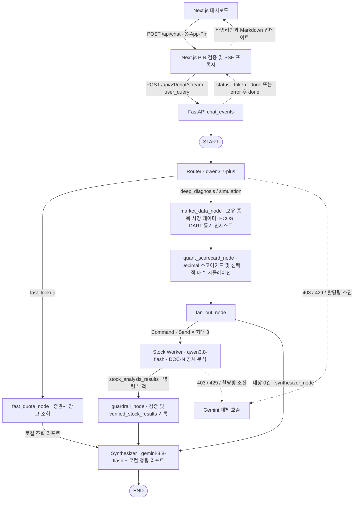

# FinGuard AI

국내 주식 계좌의 공시, 오버행, 수급, 뉴스, 환율·금리 위험을 점검하는 단일 사용자용 포트폴리오 진단 도구입니다. 보통주·우선주·ETF·ETN을 지원하며, 증권사 API는 잔고·시세·주문 가능 현금 조회에 사용합니다. 매수 시뮬레이션은 조회한 계좌 스냅샷으로 계산합니다. [PRD v3.8](docs/finguard_ai_prd_v3.8.md)

## 아키텍처

- **정형 수치와 비정형 분석 분리.** Zero-Hallucination 설계 원칙에 따라 정형 API와 오버행 DB에서 가져온 수치는 Python Decimal 엔진이 계산합니다. 스코어카드, 오버행 희석률, 보유 평단가, 예상 평단가는 리포트 생성기가 직접 표시합니다. LLM은 종목명·비중(%)·수익률(%)·정량 점수와 DART 공시 청크를 해석합니다. 원화 금액, 보유 수량, 계좌번호, 사용자 질문은 워커와 종합 노드에 전달하지 않습니다. 워커별 DOC-N 별칭은 실제 공시 접수번호로 변환되고, 미등록 별칭이나 원시 접수번호가 있는 문장은 Kiwi 문장 단위로 제외합니다.
- **기업 범위 한정 하이브리드 검색.** PostgreSQL 15의 pgvector는 corp_code B-tree로 기업 범위를 먼저 좁힌 뒤 코사인 Exact Scan을 수행합니다. Kiwi 형태소 기반 TSVECTOR GIN·ts_rank 결과를 결합하고 로컬 리랭커로 후보의 순서를 조정합니다. DART 표는 Markdown으로 변환하며 분할 시 헤더를 복제합니다. 오버행 정정 적재는 UNIQUE NULLS NOT DISTINCT 복합키를 사용합니다.
- **RTX 5060 8GB VRAM 환경.** CUDA 12.8 및 PyTorch FP16으로 BAAI/bge-m3와 BAAI/bge-reranker-v2-m3를 직접 로드합니다. Uvicorn 워커는 1개이며 임베딩과 리랭킹이 asyncio.Semaphore(1)인 gpu_semaphore를 공유합니다. 리랭킹은 최대 길이 1,024와 배치 8을 사용합니다.
- **우선주 매핑과 ETF 우회.** 종목 마스터 동기화가 동일 crno의 보통주 corp_code를 우선주에 전파합니다. ETF·ETN 등 비주식 자산은 DART, 보호예수, 재무 스코어카드 및 종목 워커를 우회하고 가격·수익률·수급을 요약합니다. Redis는 증권사 OAuth, 외부 API 캐시, 기업별 DART 인제스트 잠금에 사용합니다.
- **Next.js 14 PIN 프록시.** 브라우저는 X-App-Pin을 담아 Next.js에 요청합니다. 서버 라우트가 APP_ACCESS_PIN을 확인하고 계좌 JSON과 SSE 스트림을 내부 FastAPI로 프록시합니다. Compose의 호스트 공개 포트는 기본적으로 127.0.0.1:3000입니다.

## LangGraph 워크플로우



FastAPI는 그래프를 시작하기 전에 첫 status(router_node, started)를 전송합니다. 완료 프레임에는 final_report와 함께 intent_type, account_summary, holdings, quant_scorecards, macro_context, simulation_result, verified_stock_results, guardrail_warnings가 담깁니다. verified_stock_results는 리듀서 없이 가드레일에서 한 번 기록합니다.

| 공개 경로 | 동작 | 내부 경로 |
| --- | --- | --- |
| GET /api/account | PIN 검증 후 잔고와 주문 가능 현금 조회 | GET /api/v1/account |
| POST /api/chat | PIN 검증 후 JSON { "user_query": "…" } 전송 및 SSE 중계 | POST /api/v1/chat/stream |
| — | 백엔드 상태 확인 | GET /health |

## 실행

### Docker Compose

NVIDIA GPU를 지원하는 Docker Compose 환경에서 저장소 루트의 .env.example을 .env로 복사해 값을 채웁니다. Compose의 기본 연결 주소는 PostgreSQL `db:5432`, Redis `redis:6379`, FastAPI `http://backend:8000`입니다. Compose 내부 주소를 바꾸려면 `COMPOSE_PGHOST`, `COMPOSE_PGPORT`, `COMPOSE_REDIS_URL`, `COMPOSE_BACKEND_INTERNAL_URL`을 설정합니다.

```powershell
Copy-Item .env.example .env
docker compose up -d --build
docker compose ps
```

POSTGRES_PASSWORD와 APP_ACCESS_PIN을 지정합니다. 종목 마스터 동기화에는 DART_API_KEY와 FSC_SERVICE_KEY가 함께 필요합니다. PyKRX 인증 데이터와 공시 분석, 외부 지표에 사용하는 환경 변수는 .env.example에 있습니다. [환경 변수 예시](.env.example)

기본 계좌 연결은 토스증권입니다. 토스증권 웹의 설정 → Open API에서 발급받은 Client ID와 Client Secret을 저장소 루트의 `.env`에 `TOSS_CLIENT_ID`와 `TOSS_CLIENT_SECRET`으로 입력합니다. 연결된 종합매매 계좌가 하나면 자동 선택합니다. 여러 개면 계좌 목록 API가 반환하는 `accountSeq`를 `TOSS_ACCOUNT_SEQ`에 지정합니다. 설정을 바꾼 뒤 `docker compose up -d backend`를 실행합니다. [토스증권 공식 API 가이드](https://developers.tossinvest.com/docs)

토스증권 연결은 국내 원화 보유 종목과 원화 매수 가능 금액을 조회합니다. API에서 전체 예수금을 제공하지 않아 요약에는 국내 주식 평가액을 표시하며, 전체 계좌 기준 현금 비중과 시뮬레이션 예상 비중은 표시할 수 없습니다. 시장 데이터는 KIS 실전 키가 구성되면 기존 KIS 조회를 사용하고, 실패하거나 키가 없으면 PyKRX로 조회합니다. 한국투자증권 계좌를 연결하려면 `BROKER_PROVIDER=kis`와 해당 계좌의 KIS 설정을 지정합니다. KIS 계좌의 실전·모의 모드는 `IS_VIRTUAL`로 선택합니다.

KIS 실전 계좌만 연결할 때는 `IS_VIRTUAL=false`, `KIS_APP_KEY`, `KIS_APP_SECRET`, `KIS_ACCOUNT_NO`를 입력합니다. 계좌 상품 코드는 기본값 `01`을 사용합니다. `KIS_VIRTUAL_*`는 시연·테스트에서 모의 계좌를 선택할 때만 필요합니다.

| 역할 | 모델 설정 및 기본값 | 공급자 키 |
| --- | --- | --- |
| Node 1 의도 분류 | `ROUTER_MODEL=qwen3.7-plus` | `DASHSCOPE_API_KEY` |
| Node 4 Top-3 종목 분석 | `WORKER_MODEL=qwen3.8-flash` | `DASHSCOPE_API_KEY` |
| Node 6 종합 진단 · Module 8 RAGAS Judge · 대체 호출 | `SYNTHESIZER_MODEL=gemini-3.8-flash` | `GEMINI_API_KEY` |

DashScope의 기본 주소는 `DASHSCOPE_BASE_URL=https://dashscope-intl.aliyuncs.com/compatible-mode/v1`입니다. 429·403 또는 할당량 소진 시 동일한 입력으로 Gemini를 한 번 호출합니다. DashScope 키만 비어 있으면 Gemini를 직접 사용합니다. 단순 조회의 라우터 대기는 최대 250ms입니다. 시간이 지나면 로컬 분류로 잔고·시세 조회를 계속합니다. 공시 검색의 임베딩과 리랭킹은 백엔드의 CUDA GPU에서 실행됩니다.

두 공급자를 모두 사용할 수 없어도 진단은 완료됩니다. 대시보드 경고 배너에서 영향을 받은 단계를 확인할 수 있고, 리포트에는 Python이 계산한 스코어카드·희석률·매수 시뮬레이션과 종목별 DOC-N 공시 링크가 남습니다.

브라우저에서 [http://127.0.0.1:3000](http://127.0.0.1:3000)을 열고 PIN을 입력합니다. 초기 PostgreSQL 볼륨에는 두 마이그레이션이 적용됩니다. 백엔드 시작 시 Module 4 마이그레이션을 재적용합니다. `DART_API_KEY`와 `FSC_SERVICE_KEY`가 모두 있으면 종목 마스터가 비어 있을 때만 동기화를 마친 뒤 Uvicorn을 시작하고, 이미 데이터가 있으면 기동을 막지 않도록 백그라운드에서 갱신합니다. 프론트엔드는 백엔드 `/health` 헬스체크가 통과한 뒤 시작합니다. GPU 모델 파일은 data/huggingface에 캐시됩니다.

### 로컬 개발

Python 3.11 가상환경, Node.js 22.18 이상, Docker가 필요합니다. 처음 한 번 가상환경을 만들고 `.env`를 채웁니다.

```powershell
uv venv --python 3.11 --seed .venv
.\.venv\Scripts\pip.exe install -r tests/requirements.txt
```

이후에는 명령 하나로 개발 서버를 띄웁니다.

```powershell
.\.venv\Scripts\python.exe scripts/dev.py
```

`scripts/dev.py`는 `.env`를 읽고 `docker-compose.dev.yml`로 DB와 Redis를 루프백 포트에 띄웁니다. 이어서 마이그레이션을 적용하고, `stock_master`가 비어 있을 때만 동기화합니다. 그다음 FastAPI(자동 리로드, http://127.0.0.1:8000)와 Next.js(http://127.0.0.1:3000)를 함께 실행합니다. 셸에 이미 설정된 환경 변수가 `.env`보다 우선합니다. Ctrl+C를 누르면 두 서버가 함께 종료되고 DB와 Redis는 계속 실행됩니다.

| 옵션 | 동작 |
| --- | --- |
| `--sync` | 종목 마스터를 강제로 다시 동기화 |
| `--api-only` | FastAPI만 실행 |
| `--api-port`, `--web-port` | 포트 변경. Compose의 프론트가 3000을 쓰고 있으면 `--web-port 3001` |
| `--no-reload` | 백엔드 자동 리로드 끄기 |
| `--no-infra` | Docker 대신 직접 설치한 PostgreSQL·Redis 사용(`.env`의 `PGHOST`, `PGPORT`, `REDIS_URL`) |

백엔드만 따로 실행할 때는 `python -m backend.server [--reload]`를 사용합니다. Windows에서도 비동기 psycopg가 동작하도록 Selector 이벤트 루프와 `workers=1`이 고정되어 있습니다. Linux·macOS에서는 `./.venv/bin/python scripts/dev.py`로 실행합니다.

## Module 8 평가

### RAGAS 공시 20건

OpenDART 공개 공시에서 전환사채·신주인수권부사채 발행, 유상증자, 최대주주 변경, 단일판매·공급계약 체결, 영업잠정실적을 각각 4개 발행사씩 선정했습니다. 각 사례에는 DART 접수번호와 원문 URL, 질문, 기준 답변, 관련·비관련 사실 발췌가 들어 있습니다. 정형 수치는 재현 가능한 고정 계좌·시장 데이터로 계산합니다. [평가 데이터셋](data/eval/ragas_benchmark_20.json)

| 지표 | 목표 | 오프라인 dry-run | 실측 |
| --- | ---: | ---: | --- |
| Faithfulness | ≥ 0.90 | 1.0000 | 미측정 |
| Context Precision | ≥ 0.85 | 1.0000 | 미측정 |
| 정형 수치 오차율 | 0.0% | 0.0% (0/80) | 미측정 |

Dry-run은 고정 검색 순위와 발췌 답변으로 검증 점수를 계산합니다. 실제 그래프, 인용 검증, SSE 토큰 재구성, 최종 Markdown 채점은 두 모드에서 모두 실행됩니다. 자동 채점기는 오버행 희석률·보유 평단가·예상 평단가·100점 스코어카드 각각을 Decimal 값으로 대조합니다. 예상 평단가는 화면과 동일하게 소수 둘째 자리로 반올림하며, 누락·중복·불일치는 각각 해당 항목의 오류로 집계합니다.

실측은 연결한 PostgreSQL의 임시 스키마에 발췌 코퍼스를 색인하고 운영 코드의 임베딩·하이브리드 검색·리랭킹·답변 생성을 실행합니다. Faithfulness는 가드레일을 거친 워커 답변과 제공 컨텍스트를, Context Precision은 검색 순서와 기준 답변을 비교합니다. 실측에는 public 스키마에 pgvector가 활성화된 DB, 스키마 생성 권한, CUDA GPU, `GEMINI_API_KEY`가 필요합니다. 종목 답변은 운영 워커와 동일하게 `WORKER_MODEL` 및 DashScope→Gemini 대체 정책을 사용합니다. Gemini Judge는 기본적으로 `SYNTHESIZER_MODEL`을 사용하며, `--judge-model`로 평가 전용 Gemini 모델을 지정할 수 있습니다. [RAGAS Faithfulness](https://docs.ragas.io/en/v0.3.9/concepts/metrics/available_metrics/faithfulness/) · [RAGAS Context Precision](https://docs.ragas.io/en/v0.3.9/concepts/metrics/available_metrics/context_precision/)

```powershell
.\.venv\Scripts\python.exe -X utf8 scripts/eval_ragas.py --dry-run --format markdown
.\.venv\Scripts\pip.exe install -r scripts/requirements-eval.txt
.\.venv\Scripts\python.exe -X utf8 scripts/eval_ragas.py --judge-model gemini-3.8-flash --format markdown
```

### SSE 지연시간

| 지표 | 목표 | 오프라인 시뮬레이션 | 실측 |
| --- | ---: | ---: | --- |
| TTFE | ≤ 0.5초 | 0.120초 | 미측정 |
| Fast Path TTFT | ≤ 1.0초 | 0.350초 | 미측정 |
| Deep Analysis Warm Cache Duration | ≤ 12.0초 | 8.000초 | 미측정 |
| Deep Analysis Cold Cache Duration | ≤ 25.0초 | 18.000초 | 미측정 |

TTFE는 첫 라우터 시작 status, TTFT는 첫 비어 있지 않은 token, 완료 시간은 성공한 done까지 측정합니다. TTFE와 Fast Path TTFT, Warm Cache Duration은 각 표본의 최댓값을 표에 사용합니다. Cold는 1회 측정합니다. Dry-run은 가상 시계와 분할된 SSE 프레임으로 파서와 집계를 재현합니다.

실측은 직접 접근 가능한 FastAPI와 일회용 테스트 DB를 사용합니다. 최근 90일에 공시가 있는 주식으로 테스트 계좌를 구성하고, 매핑된 보유 주식의 corp_code를 모두 전달합니다. 테스트 DB는 대상 기업의 최근 공시 청크가 없는 상태에서 시작합니다. 스크립트가 Fast Path 이후 Cold를 실행해 청크 적재를 확인하고 같은 계좌로 Warm을 반복합니다. LATENCY_TEST_DSN에는 FastAPI와 같은 DB의 접속 문자열을 지정합니다. --corp-code는 실제 보유 종목에 맞춰 반복합니다.

```powershell
.\.venv\Scripts\python.exe -X utf8 scripts/benchmark_latency.py --dry-run --format markdown
.\.venv\Scripts\python.exe -X utf8 scripts/benchmark_latency.py --base-url http://127.0.0.1:8000 --corp-code 00126380 --samples 3 --format markdown
```

두 스크립트는 기본적으로 JSON을 출력합니다. 종료 코드 0은 목표 충족, 1은 목표 미달, 2는 설정 또는 실행 오류를 뜻합니다.

## 테스트

```powershell
.\.venv\Scripts\python.exe -m pytest tests/test_module8_eval.py
.\.venv\Scripts\python.exe -m pytest
npm --prefix frontend test
npm --prefix frontend run build
```

Module 4 통합 테스트는 기본적으로 내장 PostgreSQL을 시작합니다. Compose DB를 사용하려면 위의 루프백 포트 오버라이드로 `db`와 `redis`를 시작하고 `PGDATABASE`, `PGUSER`, `PGPASSWORD`를 설정합니다. 테스트는 pgvector가 설치된 DB에 별도 스키마를 만들고 종료 시 삭제합니다.

```powershell
$env:MODULE4_TEST_DSN = 'host=127.0.0.1 port=55432'
.\.venv\Scripts\python.exe -m pytest tests/test_module4_rag.py
.\.venv\Scripts\python.exe -m pytest
```

최종 스모크는 RTX에서 FP16 모델 두 개의 적재 피크를 측정하고 임시 루프백 서버에서 모의 계좌와 공시로 FastAPI 및 Next.js의 실제 HTTP 스트림을 검증합니다. 스크립트가 임시 PIN과 포트를 지정합니다. Hugging Face 캐시가 이미 준비된 환경에서는 `HF_HUB_OFFLINE=1`을 추가할 수 있습니다.

```powershell
npm --prefix frontend ci
npm --prefix frontend run build
$env:HF_HOME = Join-Path $PWD 'data/huggingface'
.\.venv\Scripts\python.exe -X utf8 scripts/smoke_test_e2e.py
```
